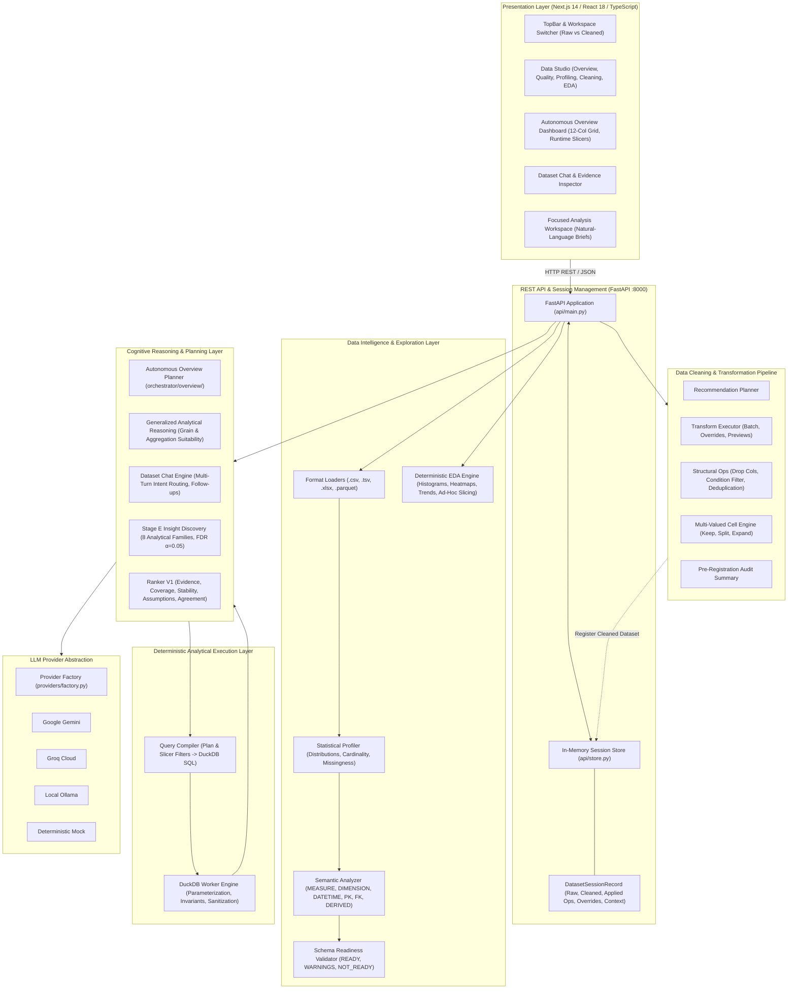

# AI-Driven Business Intelligence & Dashboard Automation Platform

An intelligent, end-to-end business intelligence platform that automates the journey from raw tabular files to statistical discovery, interactive data cleaning, exploratory analysis, conversational querying, and Power BI-style interactive dashboards.

The platform pairs a deterministic data processing and query compilation engine (**DuckDB**, **Pandas**, **NumPy**) with a multi-provider cognitive layer (**Google Gemini**, **Groq**, **Local Ollama**) governed by strict mathematical safeguards (Benjamini-Hochberg FDR control, numeric grounding guards, and non-mutating dataset immutability).

---

## 🏛️ System Architecture

The platform enforces a strict separation between presentation, cognitive planning, deterministic execution, and stateful dataset session management:



### Architectural Boundaries & Safeguards
1. **Zero Hallucination Numbers**: LLMs never compute sums, averages, totals, p-values, or correlation coefficients. All calculations are executed deterministically by DuckDB and NumPy/SciPy.
2. **Number Grounding Guard**: Every statistic emitted in conversational text or dashboard narration is verified against exact query execution tables; discrepancies are intercepted and corrected before display.
3. **Zero Database Coupling in Orchestrator**: The cognitive reasoning layer contains **zero imports of `duckdb`**. SQL synthesis and query execution belong exclusively to `engine/`.
4. **Dataset Immutability**: Uploaded datasets are wrapped in immutable `CanonicalDataset` objects. All transformations, filters, and cleanings execute on deep copies. Registering a cleaned dataset creates an independent first-class dataset (`ds_<stem>_cleaned_<uuid>`), preserving the raw dataset in its original state.
5. **Provider Agnosticism**: Standardized `LLMClient` interface supports Google Gemini, Groq, offline Ollama, or pure deterministic offline fallbacks.

---

## 🚀 Key Capabilities & Features

### 1. Ingestion & Semantic Profiling (`ingestion/`, `intelligence/`)
- **Multi-Format Ingestion**: Loads `.csv`, `.tsv`, `.xlsx`, and `.parquet` files up to 100MB with automatic delimiter detection and schema normalization.
- **Statistical Profiler (`intelligence/profiler.py`)**: Computes cardinalities, distinct-to-total ratios, missingness rates, skewness, interquartile ranges (IQR), and distribution quantiles.
- **Rule-Based Semantic Analyzer (`intelligence/semantic_analyzer.py`)**:
  - Classifies columns into `MEASURE`, `DIMENSION`, `DATETIME`, or `IDENTIFIER`.
  - **Entity Sub-Roles**: Differentiates `PRIMARY_KEY` (near-unique entity identifiers, ratio $\ge 0.90$) from `FOREIGN_KEY` (repetitive identifiers like `CustomerID`, `StoreID` retained as valid grouping dimensions).
  - **Algebraic Composite Measures**: Automatically detects derived measures ($M_3 \approx M_1 \times M_2$, $M_1 + M_2$, or $M_1 / M_2$, e.g., `TotalSales == Quantity * UnitPrice`) with configurable tolerance (`1e-3`) and assigns the `DERIVED` sub-role.
- **Schema Readiness Assessment (`intelligence/schema_validator.py`)**: Gates analytical execution (`READY`, `READY_WITH_WARNINGS`, `NOT_READY`), preventing queries against malformed schemas.

### 2. Data Studio & Cleaning Pipeline (`cleaning/`, `frontend/app/data-studio/`)
- **5-Tab Analytical Studio**: Overview, Quality, Profiling, Cleaning, and EDA tabs.
- **Quality Health Scoring (`intelligence/quality_assessor.py`)**: Global score (0–100%) and metrics for Completeness, Uniqueness, Consistency, and Validity.
- **Automated Cleaning Recommendations (`cleaning/planner.py`)**: Identifies missing values, whitespace anomalies, unparsed currency/percentage strings, and duplicate rows.
- **Preview & Dry-Run Lifecycle (`cleaning/executor.py`)**: Generates cell-level diffs and row/column impact previews before applying changes.
- **Structural Operations (`cleaning/structural.py`)**:
  - Single and multi-column removal.
  - Condition-based row filtering (`==`, `!=`, `<`, `>`, `<=`, `>=`, `contains`, `missing`) with `AND`/`OR` logic.
  - Duplicate row removal (`keep='first'` or `'last'`).
  - User semantic role overrides with physical dtype safety checks.
- **Multi-Valued Cell Handling (`cleaning/multivalue.py`)**:
  - Delimiter detection (`,`, `;`, `|`, `/`, `:`) with thousands-separator financial guard (avoiding false positives on numbers like `1,250.50`).
  - Non-mutating strategies: `KEEP AS IS`, `SPLIT INTO COLUMNS`, and `EXPAND INTO ROWS` (unnesting).
- **Cleaned Dataset Summary**: Pre-registration audit card detailing operations applied, row/column delta, null reductions, and duplicates removed.
- **Cleaned Dataset Registration**: Promotes cleaned in-memory drafts to independent, first-class registered datasets with automatic re-profiling, preserving the raw dataset unmutated.
- **Data Export**: Direct CSV and XLSX downloads (`GET /api/datasets/{dataset_id}/download?format=csv|xlsx`).

### 3. Exploratory Data Analysis (EDA) Engine (`intelligence/eda.py`)
- **Automated EDA Summary**:
  - 10-bin numeric distribution histograms with sample skewness indicators.
  - Categorical top 10 frequency bar charts with high-cardinality alerts.
  - Pairwise Pearson correlation matrix with constant-column divide-by-zero guards.
  - Chronological temporal trends and aggregations.
  - 5–10 automated, evidence-grounded factual observations.
- **Manual Bivariate & Multivariate Exploration**:
  - Type-aware chart selection: Scatter (Numeric $\times$ Numeric), Line (Datetime $\times$ Numeric), Grouped Bar (Categorical $\times$ Numeric).
  - Deterministic sampling down to 1,000 points for large scatter datasets.
- **Light & Dark Theme Visuals**: Dynamic Recharts SVG marks reacting smoothly to theme switching via centralized tokens (`lib/chartTheme.ts`).

### 4. Autonomous Overview Dashboard (`orchestrator/overview/`)
- **Zero Hardcoded Dictionaries**: Operates on arbitrary uploaded datasets using generalized analytical reasoning:
  - **Dataset Grain Inference**: Differentiates `ENTITY`, `TRANSACTION_EVENT`, `REPEATED_OBSERVATION`, and `GROUPED_SUMMARY`.
  - **Measure Aggregation Suitability**: Evaluates additive/extensive measures (`SUM`) vs intensive rate/price/percentage measures (`AVG`, `MEDIAN`).
  - **Dimension Selection**: Prunes high-cardinality primary keys and focuses on meaningful categoricals and foreign keys.
  - **Counting Candidates**: Synthesizes count metrics for datasets lacking continuous measures.
- **Diversity-Aware Ranking**: Selects balanced perspectives across KPIs, Rankings, Compositions, Trends, Gaps, and Correlations.
- **Power BI-Style 12-Column Grid Layout**:
  - Row 1: KPI context strip (up to 4 summary cards).
  - Row 2: Hero visualization ($w=8$) paired with side composition donut ($w=4$).
  - Row 3+: Balanced supporting grid ($w=6$ or $w=4$).
- **Interactive Slicers & Dynamic Cross-Filtering**:
  - `date_range` slider and `multi_select` dimension checkboxes.
  - Endpoint `POST /api/dashboard/{spec_id}/tile/{tile_id}/query` dynamically recompiles candidate plans into parameterized DuckDB SQL with injected filters in real time.
- **Robustness Floor (`ROBUSTNESS_FLOOR = 0.35`)**: Amber **"Low stability"** warning badges on volatile bootstrap estimates.

### 5. Conversational Dataset Chat & Evidence Grounding (`orchestrator/chat/`)
- **Multi-Turn Conversational Analytics**: Natural language interaction with conversational memory, pronoun binding, and follow-up suggestion generation.
- **Intent Classification (`ChatIntentClassifier`)**: Categorizes queries into analytical queries, follow-ups, comparisons, metadata requests, insight explanations, or provenance queries.
- **NL-to-SQL Execution (`orchestrator/query_engine.py`)**: Translates questions into structured plans executed securely against DuckDB.
- **Evidence Inspector (`EvidenceInspector.tsx`)**: Transparent drawer displaying compiled DuckDB SQL, query execution timing (ms), row counts, filters applied, statistical effect sizes, and grounding proofs.

---

## 🔄 Main User Workflow

```
┌─────────────────┐       ┌─────────────────┐       ┌─────────────────┐
│ 1. Upload File  │ ────> │ 2. Inspect Data │ ────> │ 3. Clean Data   │
│ (.csv, .xlsx,   │       │ (Quality, Stats │       │ (Transform, Row/│
│  .tsv, .parquet)│       │  Profiling)     │       │  Col Ops, Unnest│
└─────────────────┘       └─────────────────┘       └────────┬────────┘
                                                             │
┌─────────────────┐       ┌─────────────────┐       ┌────────▼────────┐
│ 6. Dataset Chat │ <───┐ │ 5. Explore EDA  │ <──── │ 4. Register or  │
│ (Conversational │     │ │ (Histograms,    │       │    Keep Raw     │
│  NL-to-SQL)     │     │ │  Correlations)  │       │ (New clean ID)  │
└────────┬────────┘     │ └─────────────────┘       └─────────────────┘
         │              │
┌────────▼────────┐     │ ┌─────────────────┐
│ 7. Autonomous   │ ────┴─│ 8. Inspect      │
│    Overview     │       │    Provenance   │
│ (12-Col BI Grid)│       │ (SQL, Grounding)│
└─────────────────┘       └─────────────────┘
```

1. **Upload Dataset**: Upload tabular data via the UI (`/upload`). The platform ingests, profiles, infers semantics, and checks schema readiness.
2. **Inspect Quality & Profile**: In Data Studio, review the Global Quality Score, check missingness rates, inspect cardinalities, and review detected column roles.
3. **Transform & Clean**: Review recommended cleaning rules, test custom transforms with dry-run previews, drop unwanted columns, filter rows, or handle multi-valued cells.
4. **Register Cleaned Dataset**: Inspect the pre-registration summary and click **Register Cleaned Dataset**. The cleaned version is saved as an independent dataset, preserving raw data untouched.
5. **Explore via EDA**: In the EDA tab, examine numeric distribution histograms, categorical bar charts, the correlation heatmap, and test ad-hoc bivariate relationships.
6. **Ask Natural Language Questions**: Open Dataset Chat or the Focused Analysis workspace to ask analytical questions (*"Show monthly sales trend by region"*).
7. **Generate Autonomous Overview**: Click **Generate Overview** to produce a complete Power BI-style dashboard without writing any queries.
8. **Inspect Evidence & Interact**: Adjust date slicers and multi-select checkboxes for instant DuckDB dynamic cross-filtering, and open the Evidence Inspector to view compiled SQL queries and statistical validation proofs.

---

## 💻 Technology Stack

| Domain | Technology | Implementation Responsibility |
| :--- | :--- | :--- |
| **Frontend Framework** | **Next.js 14 (App Router)** | Client-side routing, layout shell, state management, and SSR page delivery |
| **Frontend UI & Icons** | **React 18**, **Tailwind CSS**, **Lucide React** | Reactive components, design token binding, accessible UI widgets |
| **Visualization Engine** | **Recharts 3.x** | SVG chart marks (bar, line, scatter, donut, histogram) with theme integration |
| **Backend REST Framework** | **FastAPI 0.100+**, **Uvicorn** | High-performance asynchronous REST API, CORS middleware, OpenAPI docs |
| **Data Processing & I/O** | **Pandas 2.0+**, **PyArrow 14+**, **OpenPyXL** | Tabular loading, structural transformations, statistical aggregations |
| **Analytical Query Engine** | **DuckDB 0.9+** | In-memory SQL execution, aggregation, dynamic filter injection |
| **Scientific Computation** | **NumPy**, **SciPy** | Benjamini-Hochberg FDR control, Pearson correlations, ANOVA effect sizes ($\eta^2$) |
| **Contract Validation** | **Pydantic V2**, **JSONSchema** | Type validation, request/response models, candidate plan schemas |
| **AI / LLM Providers** | **Google Gemini** (`google-genai`), **Groq**, **Ollama** | Multi-provider plan synthesis, chat interaction, narrative formulation |

---

## 🛠️ Prerequisites & Local Setup

### 1. Prerequisites
- **Python**: Version `3.10` or higher (`3.11` recommended; tested up to `3.13`)
- **Node.js**: Version `18.x` or higher & **npm** `9.x+`
- **Operating System**: Windows (PowerShell), macOS, or Linux
- *(Optional)* [Ollama](https://ollama.ai/) for 100% offline local LLM execution

---

### 2. Backend Setup
From the repository root:

```powershell
# Windows (PowerShell)
python -m venv .venv
.\.venv\Scripts\Activate.ps1

# macOS / Linux
# python3 -m venv .venv
# source .venv/bin/activate

# Install dependencies
pip install -r requirements.txt
```

---

### 3. Frontend Setup
From the repository root:

```powershell
cd frontend
npm install
cd ..
```

---

### 4. Environment Configuration
Copy the configuration template:

```powershell
# Windows (PowerShell)
Copy-Item .env.example .env

# macOS / Linux
# cp .env.example .env
```

Configure your preferred LLM provider in `.env`:

```ini
# Provider options: 'gemini' | 'groq' | 'ollama'
PROVIDER=gemini

# Google Gemini (https://aistudio.google.com/)
GEMINI_API_KEY=your_gemini_api_key_here
GEMINI_MODEL=gemini-2.5-flash

# Groq Cloud (https://console.groq.com/keys)
GROQ_API_KEY=your_groq_api_key_here
GROQ_MODEL=llama-3.3-70b-versatile

# Local Ollama (No API key needed; offline)
OLLAMA_HOST=http://localhost:11434
OLLAMA_MODEL=llama3

# Frontend API URL
NEXT_PUBLIC_API_URL=http://localhost:8000/api
```

*(Note: If no API keys are provided, the platform automatically utilizes deterministic rule-based algorithms for candidate generation and analytical query execution).*

---

### 5. Running the Application

Open two terminal windows:

#### Terminal 1: Backend API Server
```powershell
# Activate venv if not already active
.\.venv\Scripts\Activate.ps1

python -m uvicorn api.main:app --port 8000 --reload
```
- API Base: `http://localhost:8000/api`
- Interactive Swagger Documentation: `http://localhost:8000/docs`

#### Terminal 2: Next.js Frontend
```powershell
cd frontend
npm run dev
```
- Web Application: `http://localhost:3000`

---

### 6. Troubleshooting Common Issues
- **Port 8000 or 3000 in use**: Ensure previous instances are closed (`Get-Process python` or `netstat -ano | findstr :8000`).
- **Frontend cannot connect to backend**: Verify `NEXT_PUBLIC_API_URL=http://localhost:8000/api` in `frontend/.env.local` or `.env`.
- **Missing Python dependencies**: Run `pip install -r requirements.txt` within the active virtual environment.
- **Provider API key errors**: Check `GET /api/providers/status` in your browser to verify API key validation and model connectivity.

---

## 📂 Repository Structure

```
.
├── api/                        # FastAPI REST application
│   ├── main.py                 # REST routes, request handlers, exception handling
│   ├── schemas.py              # Pydantic request and response schemas
│   └── store.py                # In-memory DatasetSessionRecord & session store
├── cleaning/                   # Data cleaning & transformation engine
│   ├── cleaner.py              # Automated cleaning rules & cleaner class
│   ├── executor.py             # Transform executor, batch apply, dry-run previews
│   ├── models.py               # Cleaning Pydantic contracts & report schemas
│   ├── multivalue.py           # Multi-valued cell detection, splitting, and unnesting
│   ├── planner.py              # Cleaning recommendation planner
│   └── structural.py           # Structural ops (drop cols, condition filter, deduplicate)
├── docs/                       # Technical documentation directory
│   ├── README.md               # Central documentation index
│   ├── system_architecture.md  # End-to-end architecture & boundaries
│   ├── data_studio_cleaning.md # Data Studio & cleaning pipeline specification
│   ├── eda_engine.md           # Exploratory Data Analysis specification
│   ├── autonomous_overview.md  # Autonomous Overview & analytical reasoning
│   ├── dataset_chat_evidence.md# Dataset Chat, NL-to-SQL & SQL provenance
│   ├── api_reference.md        # Comprehensive REST API reference manual
│   └── ...                     # Specialized algorithm & contract documents
├── engine/                     # Deterministic execution layer
│   ├── compiler.py             # Plan and slicer filter compiler to DuckDB SQL
│   ├── duckdb_executor.py      # DuckDB connection management & query execution
│   └── sanitizer.py            # NaN, Infinity, and null output sanitizer
├── frontend/                   # Next.js 14 web application
│   ├── app/                    # App Router pages (/, /data-studio, /upload, /analysis)
│   ├── components/             # Reusable React components (EvidenceInspector, Chat, etc.)
│   │   └── data_studio/        # 5 Data Studio tabs (Overview, Quality, Profiling, Cleaning, EDA)
│   ├── lib/                    # API client (api.ts), theme tokens (theme.ts, chartTheme.ts)
│   └── package.json            # Frontend dependencies & scripts
├── ingestion/                  # Multi-format tabular data loaders
│   ├── loaders/                # CSVLoader, TSVLoader, ExcelLoader, ParquetLoader
│   └── models.py               # CanonicalDataset, DatasetMetadata, ColumnMetadata
├── intelligence/               # Statistical intelligence & profiling
│   ├── eda.py                  # Deterministic EDA Engine
│   ├── profiler.py             # Statistical profiler (cardinality, quantiles, IQR)
│   ├── quality_assessor.py     # Quality scoring (completeness, uniqueness, validity)
│   ├── schema_validator.py     # Schema readiness gate (READY, NOT_READY)
│   └── semantic_analyzer.py    # Semantic role classifier (MEASURE, DIMENSION, PK/FK)
├── orchestrator/               # Cognitive planning & insight discovery
│   ├── chat/                   # Multi-turn Dataset Chat engine & intent classifiers
│   ├── discovery/              # Candidate enumeration & Benjamini-Hochberg FDR control
│   ├── insights/               # Evidence-grounded insights & narrative generator
│   ├── overview/               # Autonomous Overview planner & generalized reasoning
│   ├── pipeline.py             # Cognitive orchestration pipeline
│   ├── query_engine.py         # NL-to-SQL analytical query engine
│   └── schemas.py              # CandidatePlan, DashboardSpec, ExecutionResult contracts
├── providers/                  # Multi-provider LLM abstraction layer
│   ├── adapters/               # Gemini, Groq, Ollama, and Mock adapters
│   └── factory.py              # Provider dynamic instantiation factory
├── tests/                      # Targeted unit, integration, and conformance test suites
├── requirements.txt            # Python dependencies
└── pytest.ini                  # Pytest configuration
```

---

## 🧪 Testing & Development Workflows

The repository uses targeted test suites to verify specific architectural modules.

### Targeted Test Execution
Run targeted test suites against specific components:

```powershell
# Test Ingestion Loaders
pytest tests/test_ingestion_loaders.py -v

# Test Profiling Engine & Statistical Calculations
pytest tests/test_profiling_engine.py -v

# Test Semantic Role Classification & Sub-Roles
pytest tests/test_semantic_analyzer.py -v

# Test Data Cleaning Layer & Transformations
pytest tests/test_cleaning_layer.py -v

# Test DuckDB Tile Dynamic Query Compilation
pytest tests/test_tile_query_backend_stage_f.py -v

# Test Benjamini-Hochberg FDR Noise Control (100 Seeds)
pytest tests/test_noise_gate_100_seeds.py -v
```

### Frontend Type Checking & Verification
From the `frontend/` directory:

```powershell
# TypeScript Type Check
npx tsc --noEmit

# Lint Check
npm run lint

# Production Build Validation
npm run build
```

*(Note: Per repository operating guidelines, do not blindly run `pytest tests/` without targeting specific modules, as full suites can be time-intensive).*

---

## ⚠️ Known Limitations & Roadmap

### Implemented & Verified Capabilities
- Multi-format ingestion (`.csv`, `.tsv`, `.xlsx`, `.parquet` up to 100MB).
- Deterministic profiling, semantic role inference, and schema readiness validation.
- Interactive Data Studio with 5 tabs, quality metrics, dry-run previews, and structural transformations.
- Multi-valued cell unnesting and splitting with thousands-separator safety guards.
- Cleaned dataset registration as distinct entities with raw data immutability.
- Deterministic EDA engine with automated distribution histograms and bivariate exploration.
- Generalized Autonomous Overview dashboard generation across arbitrary datasets without hardcoded dictionaries.
- 12-column Power BI-style dashboard grid with date/multi-select slicers and live DuckDB dynamic cross-filtering.
- Multi-turn Dataset Chat with NL-to-SQL translation, execution timings, and SQL provenance inspection.

### Current Development-Stage Limitations
1. **In-Memory Session Store**: Datasets and conversation histories are stored in server memory (`api/store.py`). Data persists across browser reloads while the server runs, but resets upon backend restart.
2. **File Size Bound**: Uploads are restricted to 100MB to preserve memory on developer machines.
3. **Observational Inference Only**: Insights and correlations reflect observational statistical relationships; the system does not claim causal inference or predictive modeling.
4. **Single-Node Execution**: DuckDB executes locally in-process; distributed cluster execution (e.g., Spark/Trino) is not currently implemented.

### Planned Roadmap
- Persistent database storage (PostgreSQL metadata + AWS S3 / MinIO object storage for tabular files).
- Role-based access control (RBAC) and multi-tenant authentication.
- Saved custom dashboards and export to PDF / interactive HTML reports.
- Advanced time-series forecasting (ARIMA / Prophet integration).

---

## 📚 Technical Documentation Directory

For deep architectural specifications, data models, and component guides, refer to the documentation index in [`docs/README.md`](docs/README.md):

| Document | Description |
| :--- | :--- |
| [`docs/system_architecture.md`](docs/system_architecture.md) | End-to-end platform architecture, component boundaries, and dataset lifecycle |
| [`docs/data_studio_cleaning.md`](docs/data_studio_cleaning.md) | Data Studio 5-tab architecture, cleaning rules, structural operations, and registration |
| [`docs/eda_engine.md`](docs/eda_engine.md) | Exploratory Data Analysis (EDA) engine, automated distributions, and theme compatibility |
| [`docs/autonomous_overview.md`](docs/autonomous_overview.md) | Autonomous Overview planner, generalized analytical reasoning, and 12-col grid layout |
| [`docs/dataset_chat_evidence.md`](docs/dataset_chat_evidence.md) | Conversational Dataset Chat, NL-to-SQL execution, SQL provenance, and grounding guards |
| [`docs/api_reference.md`](docs/api_reference.md) | Complete REST API specification for all backend endpoints and request schemas |
| [`docs/stage_e_insight_discovery.md`](docs/stage_e_insight_discovery.md) | Stage E insight discovery, candidate enumeration, and Benjamini-Hochberg FDR control |
| [`docs/stage_f_power_bi_dashboard.md`](docs/stage_f_power_bi_dashboard.md) | Power BI 12-column grid geometry, runtime slicers, and DuckDB dynamic cross-filtering |
| [`docs/column_roles.md`](docs/column_roles.md) | Semantic roles (`MEASURE`, `DIMENSION`, `DATETIME`, `IDENTIFIER`, `DERIVED`) |
| [`docs/architecture_boundaries.md`](docs/architecture_boundaries.md) | Cognitive loop boundaries, ambiguity gating, and LLM provider decoupling |
| [`docs/canonical_data_model.md`](docs/canonical_data_model.md) | Canonical data model representations and immutability invariants |
| [`docs/schema_readiness.md`](docs/schema_readiness.md) | Schema readiness gate rules and structural validation checks |
| [`docs/profiling_engine.md`](docs/profiling_engine.md) | Statistical profiler algorithms and calculation specifications |
| [`docs/known_issues.md`](docs/known_issues.md) | Known issues log, tracking history, and resolved defect catalog |

---

## 📄 License

This project is licensed under the License. See [LICENSE](LICENSE) for details.
