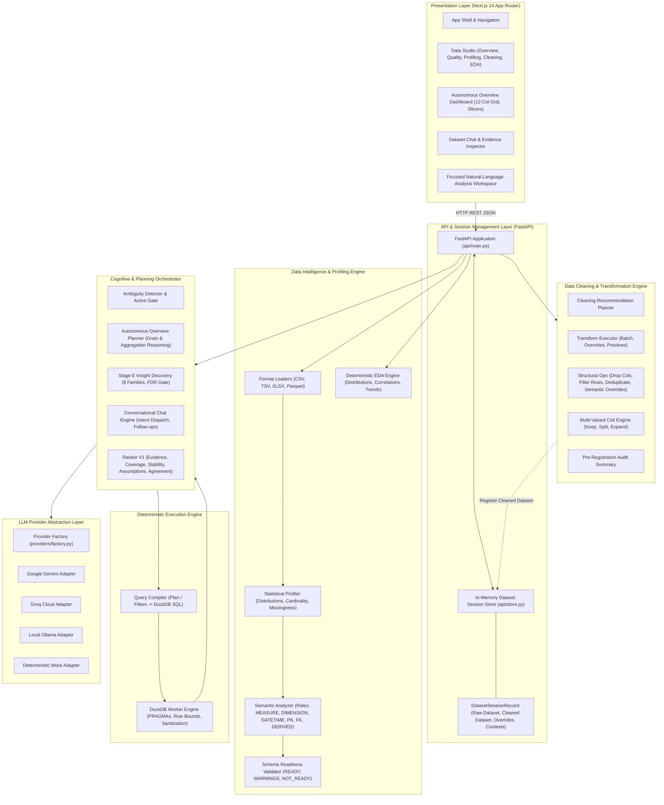
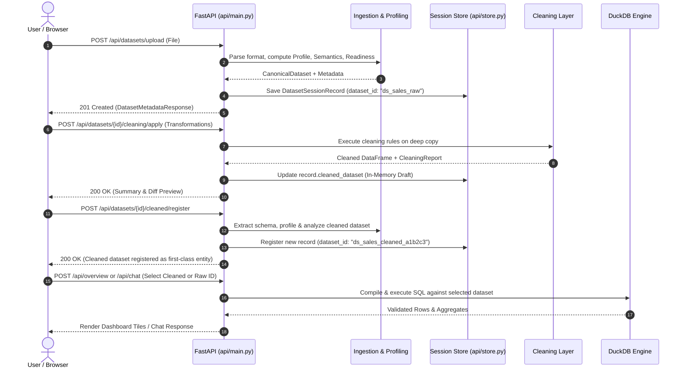

# System Architecture & Technical Design

**Status:** IMPLEMENTED & AUDITED  
**Audience:** Software Engineers, Data Architects, Machine Learning Engineers  

---

## 1. High-Level Architectural Overview

The **AI-Driven Business Intelligence & Dashboard Automation Platform** is architected as a decoupled, multi-tier system separating user interaction, cognitive reasoning, deterministic analytical computation, and stateful dataset session management.

---

## 2. Core Architectural Principles & Boundaries

The architecture maintains four strict isolation boundaries to guarantee reliability, auditability, and safety:

### 2.1 Deterministic vs. Cognitive Separation
- **No Hallucinated Numbers**: LLM providers never compute aggregations, averages, totals, or p-values. LLMs are restricted strictly to proposing semantic plan targets, formulating structured hypotheses, or generating narrative commentary.
- **Engine Ownership of Math**: All computations, filter evaluations, group-by queries, statistical tests (ANOVA, Pearson correlations, Benjamini-Hochberg FDR adjustments), and chart coordinates are computed deterministically by **DuckDB** and scientific Python libraries (`numpy`, `scipy`).
- **Number Grounding Guard**: Generated narrative text is verified by an automated grounding guard to ensure that every emitted numeric token matches exact engine execution output.

### 2.2 Cognitive Layer Independence from Databases
- The cognitive orchestrator (`orchestrator/`) contains **zero imports of `duckdb`**.
- All SQL construction, session creation, PRAGMA configuration, query parameterization, and output sanitization belong exclusively to `engine/`.
- Communication between the orchestrator and execution layer occurs solely via typed contracts (`CandidatePlan`, `FilterSpec`, `ExecutionResult`).

### 2.3 Provider-Agnostic LLM Layer
- The system interacts with language models through the abstract `LLMClient` interface (`providers/base.py`).
- Implementations exist for **Google Gemini**, **Groq Cloud**, **Local Ollama**, and **Deterministic Mock**.
- Switching providers requires modifying a single environment variable (`PROVIDER=gemini|groq|ollama`) without altering pipeline code.
- If no external LLM credentials exist, the platform gracefully falls back to deterministic rule-based algorithms.

### 2.4 Non-Mutating Data Immutability
- Input raw datasets represented as `CanonicalDataset` are **strictly immutable**.
- All cleaning operations (normalization, imputation, structural drops, row filters, multi-value unnesting) operate exclusively on explicit deep copies.
- Registering a cleaned dataset creates an independent first-class dataset entity with its own distinct dataset ID (`ds_<stem>_cleaned_<uuid>`), preserving the raw dataset in its pristine original state.

---

## 3. Dataset Lifecycle & Session Management

Dataset state is tracked in an in-memory session registry (`api/store.py`):

### 3.1 `DatasetSessionRecord` Responsibilities
Each uploaded dataset is stored in a `DatasetSessionRecord` containing:
- `dataset`: The immutable raw `CanonicalDataset`.
- `profile`: Statistical profile metrics (cardinalities, null rates, quantiles).
- `semantic_profile`: Inferred column roles (`MEASURE`, `DIMENSION`, `DATETIME`, `IDENTIFIER`).
- `readiness`: Schema viability assessment (`READY`, `READY_WITH_WARNINGS`, `NOT_READY`).
- `cleaned_dataset`: In-memory cleaned dataset draft prior to or following registration.
- `applied_operations`: Authoritative audit log of transformations applied to this dataset.
- `user_semantic_role_overrides`: User-specified role modifications overriding automated inference.
- `conversations`: Active conversational multi-turn context threads keyed by `conversation_id`.

---

## 4. Analytical Execution Layer (`engine/`)

The analytical engine guarantees safe, isolated, and high-performance SQL execution on tabular data:

1. **In-Memory DuckDB Instances**: Each query executes in an isolated or shared in-memory DuckDB environment.
2. **Schema Sanitization**: Column names containing special characters or spaces are escaped into safe SQL identifiers.
3. **Parameter Injection Prevention**: Slicer and dynamic cross-filtering clauses pass through strict type checking, operator whitelisting, and parameter validation.
4. **NaN and Infinity Sanitization**: Output records are sanitized to prevent IEEE floating-point invalid values (`NaN`, `Infinity`, `-Infinity`) from breaking downstream JSON serialization.
5. **Execution Bounds**: Queries execute with strict row limit bounds and timeout controls to prevent memory exhaustion on large datasets.

---

## 5. Frontend Presentation Layer (`frontend/`)

Built with **Next.js 14 App Router**, **React 18**, and **TypeScript**:

- **App Shell & TopBar**: Provides persistent workspace navigation, quick dataset switching (toggle between raw and cleaned versions), and light/dark theme toggling.
- **Data Studio (`/data-studio`)**: 5-tab workspace designed for data analysts:
  - *Overview*: High-level metadata, dimension/measure counts, data preview table.
  - *Quality*: Comprehensive data quality health score, missingness indicators, and integrity alerts.
  - *Profiling*: Column-by-column statistical metrics, quantiles, distinct ratios, and min/max/median values.
  - *Cleaning*: Interactive recommendation review, custom transformations, structural row/column operations, multi-valued cell handling, pre-registration summary, registration, and CSV/XLSX export.
  - *EDA*: Automated histograms, categorical frequencies, correlation matrix, chronological trends, observations, and manual bivariate/multivariate ad-hoc queries.
- **Autonomous Overview Dashboard (`/`)**: 12-column responsive grid featuring KPI context strips, hero visuals, side composition donuts, supporting charts, interactive slicers (`date_range`, `multi_select`), and dynamic tile cross-filtering.
- **Dataset Chat & Evidence Inspector**: Multi-turn conversational interface with natural language querying, execution timing, row count indicators, and deep SQL provenance inspection.
- **Centralized Theme Tokens (`frontend/lib/theme.ts`, `frontend/lib/chartTheme.ts`)**: Enterprise warm-palette design system with complete light and dark mode support for UI elements and SVG chart marks.
